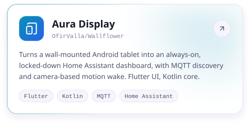
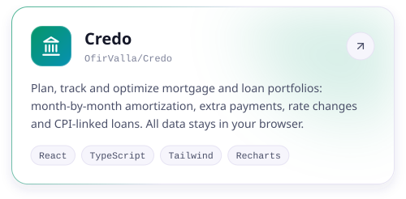
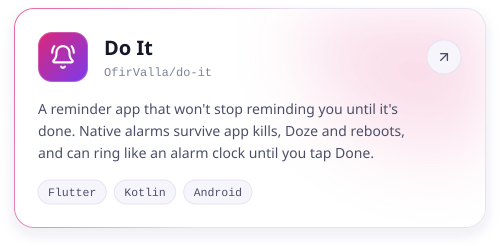
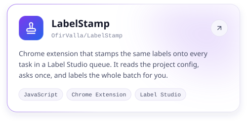
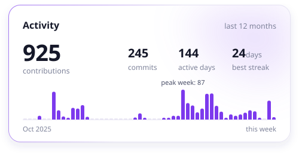
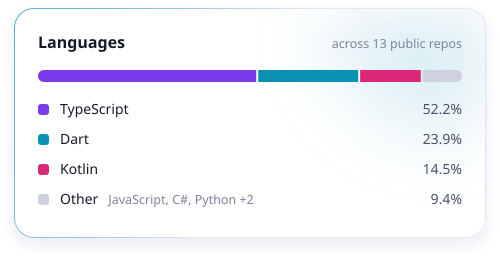
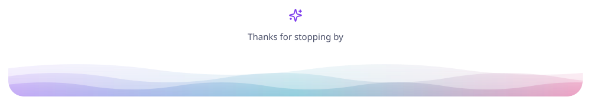

<!--
  Profile README for github.com/OfirValla.
  Every image has a dark and a light version and is generated from scripts/profile.config.mjs.
  Stats and the activity list are refreshed by .github/workflows/refresh-profile.yml.
-->

<picture>
  <source media="(prefers-color-scheme: dark)" srcset="./assets/header-dark.svg">
  
</picture>

  I build software end to end: .NET backends, React frontends, and Android apps for the phone in your pocket
  or the tablet on your wall. Most of my side projects start with a small annoyance at home and end with a tool that fixes it.

 

<picture>
  <source media="(prefers-color-scheme: dark)" srcset="./assets/title-stack-dark.svg">
  
</picture>

<picture>
  <source media="(prefers-color-scheme: dark)" srcset="./assets/stack-dark.svg">
  
</picture>

<picture>
  <source media="(prefers-color-scheme: dark)" srcset="./assets/title-projects-dark.svg">
  
</picture>

  <a href="https://github.com/OfirValla/Wallflower"><picture><source media="(prefers-color-scheme: dark)" srcset="./assets/project-aura-display-dark.svg"></picture></a>
  <a href="https://github.com/OfirValla/Credo"><picture><source media="(prefers-color-scheme: dark)" srcset="./assets/project-credo-dark.svg"></picture></a>
  <a href="https://github.com/OfirValla/do-it"><picture><source media="(prefers-color-scheme: dark)" srcset="./assets/project-do-it-dark.svg"></picture></a>
  <a href="https://github.com/OfirValla/LabelStamp"><picture><source media="(prefers-color-scheme: dark)" srcset="./assets/project-labelstamp-dark.svg"></picture></a>

<picture>
  <source media="(prefers-color-scheme: dark)" srcset="./assets/title-exploring-dark.svg">
  
</picture>

<picture>
  <source media="(prefers-color-scheme: dark)" srcset="./assets/exploring-dark.svg">
  
</picture>

<picture>
  <source media="(prefers-color-scheme: dark)" srcset="./assets/title-stats-dark.svg">
  
</picture>

  <picture><source media="(prefers-color-scheme: dark)" srcset="./assets/stats-activity-dark.svg"></picture>
  <picture><source media="(prefers-color-scheme: dark)" srcset="./assets/stats-languages-dark.svg"></picture>

<picture>
  <source media="(prefers-color-scheme: dark)" srcset="./assets/title-activity-dark.svg">
  
</picture>

<!-- ACTIVITY:START -->
- `Sep 19` &nbsp;🔨 Pushed to [LabelStamp](https://github.com/OfirValla/LabelStamp)
- `Sep 09` &nbsp;🔨 Pushed to [do-it](https://github.com/OfirValla/do-it)
<!-- ACTIVITY:END -->

<picture>
  <source media="(prefers-color-scheme: dark)" srcset="./assets/footer-dark.svg">
  
</picture>
